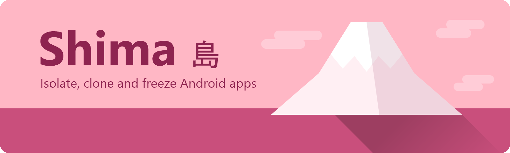
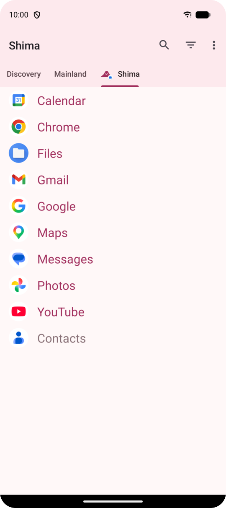
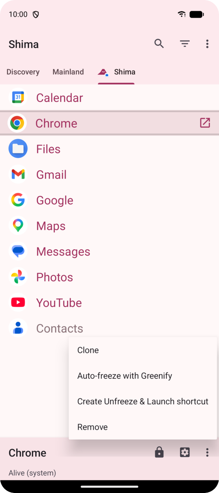
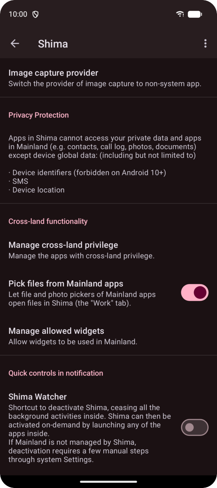
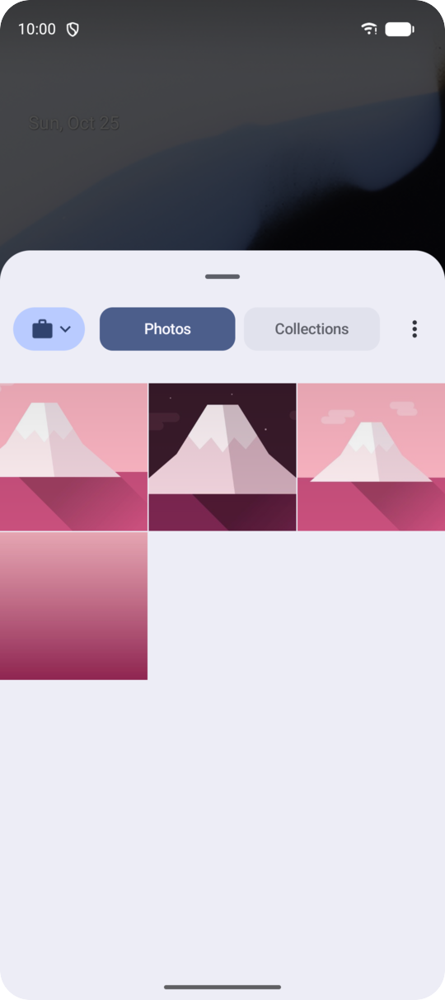

<p align="center">
  <picture>
    <source media="(prefers-color-scheme: dark)" srcset="art/readme/banner-dark.png">
    
  </picture>
</p>

<p align="center">
  <a href="https://github.com/TheyCallMeJuzou/shima/releases/latest"></a>
  
  
  <a href="LICENSE"></a>
</p>

<p align="center">
  <b>A de-Googled, Material 3 fork of <a href="https://github.com/oasisfeng/island">Island</a>.</b><br>
  Keep the apps you don't fully trust in Android's work profile: walled off from your personal data,<br>
  frozen while you're not using them, and cloned when you need a second account.
</p>

<p align="center">
  <a href="#download">Download</a> ·
  <a href="#why-shima">Why Shima</a> ·
  <a href="#screenshots">Screenshots</a> ·
  <a href="#shima-vs-island">Shima vs Island</a> ·
  <a href="#building">Building</a>
</p>

## Why Shima

<table>
<tr>
<td width="50%" valign="top">


### De-Googled
Island's Google Analytics and Firebase (Analytics, Crashlytics, Remote Config) are gone. Shima doesn't phone home:
events and errors only go to logcat on your own device.
</td>
<td width="50%" valign="top">


### Files across the border
Turn on *Pick files from Mainland apps* and the file and photo pickers of your personal apps get a **Work** tab
with Shima's files. Sharing between both sides works too.
</td>
</tr>
<tr>
<td width="50%" valign="top">


### Material 3
A fresh look built on a sakura colour scheme, in light and dark, with new Settings and dialogs.
Prefer your wallpaper's colours? Switch on Material You (Android 12+).
</td>
<td width="50%" valign="top">


### Its own island
Shima has its own app ID, so it installs next to Island without clashing. It stays close to upstream,
so Island's fixes keep flowing in.
</td>
</tr>
</table>

**And everything Island already does:**

- **Isolate**: apps in Shima can't see your contacts, call log, photos or files in Mainland (your personal profile).
- **Clone**: run a second copy of an app, for example with another account.
- **Freeze**: frozen apps can't run, sync or send notifications until you unfreeze them, and *Unfreeze & Launch*
  shortcuts make that one tap.
- **Deactivate**: Shima Watcher pauses the whole work profile and every background activity in it.
- **Supervise permissions**: take back location, SMS or device identity access even from apps that were granted it (Android 9+).
- **Open API**: other apps (like Greenify) can use Shima's powers with your permission.

## Screenshots

<table>
<tr>
<td align="center"><br><sub>Apps in Shima</sub></td>
<td align="center"><br><sub>Clone, freeze, shortcuts</sub></td>
<td align="center"><br><sub>Settings, dark theme</sub></td>
<td align="center"><br><sub>Picking Shima's photos<br>from a personal app</sub></td>
</tr>
</table>

## Shima vs Island

| | Island | Shima |
|---|:---:|:---:|
| Google Analytics & Firebase | included | **removed** |
| Personal apps can pick files from the work profile | — | ✅ opt-in |
| Material 3 design | — | ✅ |
| Material You colours | — | ✅ opt-in, Android 12+ |
| Builds from public source | needs an unpublished module | ✅ |
| Get it from | Google Play | [GitHub](https://github.com/TheyCallMeJuzou/shima/releases) / [Gitea](https://git.9auth.com/2B/shima/releases) releases |

## Download

1. Download `shima-<version>.apk` from the [latest release](https://github.com/TheyCallMeJuzou/shima/releases/latest)
   (also mirrored on [Gitea](https://git.9auth.com/2B/shima/releases)).
2. Install it, open Shima and follow the setup to create the work profile.

> [!IMPORTANT]
> **Coming from Island?** Android allows only one app to manage the work profile. Remove Island's work profile first:
> in Island, Settings → Scoped Settings → Island → *Destroy permanently*, or in system Settings under Accounts → Work →
> *Remove work profile*. This deletes the apps and data inside it.

> [!NOTE]
> Shima owns your work profile, so updates must be signed with the same key. Install updates only from these releases:
> an APK signed with a different key can only be installed after removing the work profile.

## Building

<details>
<summary><b>Build instructions</b></summary>

Requirements: JDK 17, Android SDK with platform `android-35` and build-tools `34.0.0`.

Shima depends on the ["deagle" library](https://github.com/oasisfeng/deagle), included as a git submodule pinned to the tested commit:

```
git clone --recurse-submodules https://github.com/TheyCallMeJuzou/shima.git
# or, in an existing clone:
git submodule update --init
```

Build the full APK with `./gradlew assembleCompleteNormalDebug` or `./gradlew assembleCompleteNormalRelease`
(output in `assembly/build/outputs/apk/`).

The project has several modules, with **assembly** as the build entry point, to support separate "light" builds of the
core modules as Gradle product flavors. The **engine** module shares its package name with the **complete** build to
inherit the profile/device owner privilege; **mobile** and the other modules can be installed and updated separately
alongside **engine** during development.
</details>

<details>
<summary><b>Release signing</b></summary>

Release builds are signed with the key described in `keystore.properties` at the project root (not in git):

```
storeFile=/path/to/shima-signing.keystore
storePassword=...
keyAlias=...
keyPassword=...
```

Without that file the release APK is unsigned.
</details>

<details>
<summary><b>CI and releases</b></summary>

Both [GitHub Actions](.github/workflows/build.yml) and [Gitea Actions](.gitea/workflows/build.yml) build debug and
signed release APKs on every push. Pushing a tag `v<versionName>` (e.g. `v6.4.2-shima.1`) to a remote publishes a
release there with the APK and the notes from [CHANGELOG.md](CHANGELOG.md). Signing uses the repository secrets
`SIGNING_KEYSTORE_BASE64`, `SIGNING_STORE_PASSWORD`, `SIGNING_KEY_ALIAS` and `SIGNING_KEY_PASSWORD`.
</details>

<details>
<summary><b>Differences from upstream, in detail</b></summary>

* Application ID, `sharedUserId`, permissions, intent actions/categories and content provider authorities use the `com.theycallmejuzou.shima` prefix.
  Java/Kotlin packages and Gradle namespaces are intentionally kept as `com.oasisfeng.island.*` to keep merging upstream changes easy.
* User-visible name is "Shima".
* The private `ninja` module (not published upstream) is dropped from the build.
* No analytics or crash reporting: events and handled exceptions are only written to logcat.
* Material 3 colour scheme generated from seed `#C94F7C` ([`art/theme/gen_theme.mjs`](art/theme/gen_theme.mjs)), optional
  system (Material You) colours, sakura launcher icon ([`art/icon/`](art/icon)), Settings on AndroidX Preference.
* Opt-in "Pick files from Mainland apps" in Shima's own settings.

To pull in upstream changes: `git fetch upstream && git merge upstream/dev`.
</details>

<details>
<summary><b>Open API</b></summary>

Shima keeps Island's open API, which lets third-party apps use the work profile's capabilities with a standard Android
runtime permission as the user's authorization. The protocol is defined in
**[class `Api`](/shared/src/main/java/com/oasisfeng/island/api/Api.java)**. Action and permission names use the
`com.theycallmejuzou.shima.*` prefix, so apps built for Island's API must target Shima explicitly.
</details>

## Contributing

Bug reports and pull requests are welcome. Shima tries to stay close to Island so upstream changes merge cleanly:
please keep changes focused and leave the `com.oasisfeng.island.*` package names as they are.

## Credits

Shima is built on [Island](https://github.com/oasisfeng/island) by Oasis Feng and its contributors, and on the
[deagle](https://github.com/oasisfeng/deagle) library. It's an independent fork, not affiliated with or endorsed by
the Island project. Licensed under the [Apache License 2.0](LICENSE), like Island.
